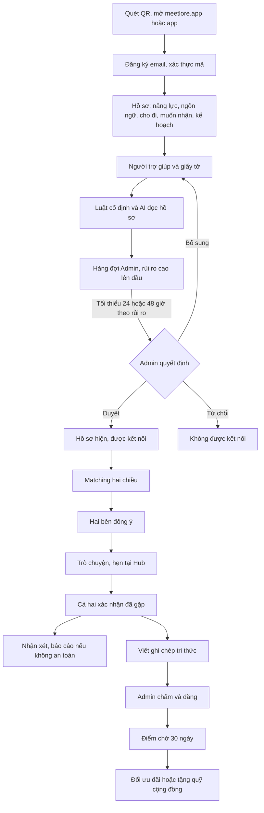

# MeetLore: thiết kế sản phẩm v1

Ngày lập: 18/11/2026. Căn cứ: bản quyết định v0.1 và các yêu cầu bổ sung của người sáng lập cùng ngày. Theo chỉ đạo, việc thiết kế và viết mã **không chờ câu trả lời của luật sư** (mục 14.1 của v0.1). Văn bản pháp lý trong app là bản nháp.

## 0. Quyết định bổ sung so với v0.1

| # | Quyết định | Cách thực hiện |
|---|---|---|
| 10 | Cơ sở lưu trú, quán cà phê, hàng quán, CLB cộng đồng, nhà văn hóa được đăng ký làm Hub | Đơn miễn phí, Admin khảo sát thực tế rồi duyệt. Không bán thứ hạng |
| 11 | Người dùng phải khai đúng thông tin và có người trợ giúp | Bắt buộc họ tên theo giấy tờ, giấy tờ, ảnh, số điện thoại và ít nhất một người trợ giúp |
| 12 | Duyệt hai bước | Bước 1 AI đọc, gắn mức rủi ro. Bước 2 Admin quyết định sau thời gian chờ tối thiểu ở dòng 15 |
| 13 | Xác thực bằng email | Mã 6 số gửi qua email. App không trả phí SMS. Có sẵn tùy chọn người dùng tự nhắn tin, cước do họ trả, đang tắt |
| 14 | Giờ tri thức | 100 điểm = 1 Giờ tri thức. Quy đổi để đo giá trị, không đổi ra tiền |
| 15 | Thời gian chờ theo rủi ro | Rủi ro thấp tối thiểu 24 giờ; trung bình và cao tối thiểu 48 giờ |
| 16 | Kết nối theo một chiều cho đi và muốn nhận | Thay cho quy tắc lấy điểm thấp hơn của hai chiều ở v0.1 mục 7. Xem mục 11 |
| 17 | Tab Hành trình | Thanh tab: Hub, Kết nối, Hành trình, Tin nhắn, Tôi. Sổ tri thức vào trang Hub và Hành trình |
| 18 | Điểm cho buổi chia sẻ | Có hệ số n/2 và phải được xác nhận. Điều chỉnh v0.1 mục 5. Xem mục 12 |
| 19 | Hiện giá trị tham chiếu bằng tiền | Người cho và người nhận thấy giá trị theo địa bàn. Không đổi trực tiếp thành tiền. Xem mục 13 |
| 20 | Điểm tuần hoàn qua cơ sở | Du khách dùng điểm lấy giảm giá; cơ sở nhận một nửa giá trị bằng điểm, phần còn lại vào quỹ app. Thay quy tắc điểm không chuyển nhượng ở phạm vi này. Xem mục 13 |

**Khung 24 đến 48 giờ (người sáng lập làm rõ):** đây là **thời gian tối thiểu** sau khi đăng ký trước khi một người thật sự trở thành người dùng, có quyền kết nối với người khác và đối tác tại Hub. Mục đích là giảm rủi ro khai báo sai. AI hỗ trợ Admin kiểm tra nhưng không rút ngắn thời gian này và không tự duyệt. Hết thời gian mà chưa có Admin duyệt thì tài khoản vẫn bị khóa quyền, không tự mở. Từ chối hoặc yêu cầu bổ sung làm được ngay. Đã chốt: rủi ro thấp tối thiểu 24 giờ; rủi ro trung bình và cao tối thiểu 48 giờ.

## 1. Luồng thông tin và vận hành

**Dữ liệu đi đâu**

| Dữ liệu | Nằm ở | Ai xem |
|---|---|---|
| Tên hiển thị, giới thiệu, chủ đề, ngôn ngữ | `profiles`, `offers`, `seeks` | Người đã xác minh, trừ người bị chặn |
| Họ tên thật, số điện thoại, giấy tờ | `identity_verifications` | Chính chủ, Admin, người xác minh |
| Người trợ giúp | `emergency_contacts` | Chính chủ; Admin khi có sự cố, có ghi lý do và nhật ký |
| Kế hoạch đi lại | `trip_plans` | Chính chủ; máy chủ dùng để matching |
| Vị trí GPS | Chỉ trên điện thoại | Không gửi lên máy chủ |
| Có mặt tại Hub | `hub_presence`, tự hết sau 2 giờ | Chỉ hiện số đếm khi từ 5 người |

## 2. Giao diện và địa chỉ

- **meetlore.app:** trang giới thiệu, trang Hub công khai, điều khoản, đăng ký cơ sở, liên kết mở app.
- **meetlore.app:** bản web sau khi đăng nhập.
- Một bộ mã Expo tạo cả hai; khi triển khai, hai tên miền cùng trỏ về bản web.
- Bản thiết kế có thể sửa nằm ở artifact "MeetLore: giao diện app".

Ngôn ngữ thị giác: giấy dó nền ấm, xanh chàm của vải vùng cao, đỏ son của con dấu. Chữ Lora và Be Vietnam Pro, đều hỗ trợ tiếng Việt.

## 3. Khai báo của người dùng

| Nhóm | Trường | Bắt buộc | Dùng để |
|---|---|---|---|
| Tài khoản | Email, mật khẩu, đồng ý điều khoản | Có | Đăng nhập |
| Cơ bản | Tên hiển thị, ngày sinh, nơi sống | Có | Chỉ lưu năm sinh sau khi kiểm tra đủ 18 tuổi |
| Giới tính | Nữ, nam, phi nhị nguyên, không muốn nói | Không | Không hiện và không xếp hạng; chỉ dùng khi người dùng chọn "chỉ gợi ý cùng giới tính" |
| Năng lực | Học vấn, nghề, kỹ năng, nghề thủ công, sáng tạo, cộng đồng, ảnh hưởng | Không | Giới thiệu, không cộng điểm matching |
| Ngôn ngữ | Bản ngữ, thành thạo, giao tiếp, đang học; có thể giúp luyện | Có | Nhãn kết nối và luyện ngôn ngữ |
| Quan tâm tri thức | 5 câu thang 1 đến 5, độ sâu mong muốn | Có | Điểm 0 đến 100, tìm người cùng nhịp |
| Cho đi | Chủ đề, độ sâu, hình thức | Có một mục | Matching |
| Muốn nhận | Chủ đề hoặc ngôn ngữ, mức quan trọng | Có một mục | Matching |
| Kế hoạch | Hub bản địa, chuyến đi có ngày | Khi gặp trực tiếp | Lọc nơi và thời gian |
| Người trợ giúp | Họ tên, quan hệ, số điện thoại, xác nhận đã báo họ | Có | An toàn |
| Danh tính | Họ tên theo giấy tờ, quốc tịch, điện thoại, thành phố, loại giấy tờ, 4 ký tự cuối, ảnh giấy tờ, ảnh chân dung | Có | Xác minh |

### Giờ tri thức và điểm

`Điểm = 100 × giờ chuyên gia tương đương × chất lượng × độ hiếm × nguồn`

| Yếu tố | Giá trị |
|---|---|
| Giờ chuyên gia tương đương | 0,25; 0,5; 1; 2; 4. Sửa thông tin tối đa 0,5; rà bản dịch tối đa 1; tư liệu tối đa 2 |
| Chất lượng, tổng 5 tiêu chí 0 đến 2 | 5-6: 0,75; 7-8: 1; 9: 1,25; 10: 1,5 |
| Từ chối | Chính xác bằng 0, nguồn hoặc đồng ý bằng 0, hoặc tổng dưới 5 |
| Độ hiếm tại Hub | Đã nhiều 1; còn ít 1,2; chưa có 1,5 |
| Nguồn | Tham khảo 1; trực tiếp 1,1; được xác nhận 1,25 |
| Giới hạn | 600 điểm mỗi bài, 600 điểm mỗi tháng |

Ví dụ: ghi chép nhuộm chàm tương đương 2 giờ, tổng chất lượng 9, Hub chưa có, được cộng đồng xác nhận: 100 × 2 × 1,25 × 1,5 × 1,25 = **469 điểm, 4,69 Giờ tri thức**.

**Vì sao thiết kế như vậy:** "giờ chuyên gia" đo công sức để tạo ra nội dung tương đương, không đo chức danh người viết. Một giờ của nghệ nhân và của giáo sư bằng nhau, đúng với quyết định không chấm theo bằng cấp. Gặp mặt thông thường và dẫn khách không sinh điểm; riêng buổi chia sẻ được xác nhận tính theo mục 12; thời gian gặp chỉ hiện là "Giờ đã chia sẻ" trong uy tín. Đổi Giờ tri thức lấy buổi học với chuyên gia nằm ngoài v0.1 nên đang tắt.

## 4. Trang và liên kết

| Nhóm | Đường dẫn |
|---|---|
| Công khai | `/`, `/h/[slug]`, `/k/[id]`, `/invite/[code]`, `/legal/[doc]`, `/partner` |
| Tài khoản | `/auth/sign-up`, `/auth/verify`, `/auth/sign-in`, `/auth/forgot` |
| Khai báo | `/onboarding/language`, `basics`, `background`, `languages`, `orientation`, `give`, `receive`, `plan`, `helper`, `alerts`, `identity`, sau đó `/verification` |
| Tab chính | `/hubs`, `/connect`, `/messages`, `/knowledge`, `/me` |
| Kết nối | `/people/[id]`, `/messages/[id]`, `/meetups/new`, `/meetups/[id]`, `/report` |
| Tri thức, điểm | `/knowledge/new`, `/me/points`, `/me/rewards`, `/me/privacy` |
| Cơ sở | `/partner/apply`, `/partner/status`, `/hub-request` |
| Quản trị | `/admin`, `/admin/verifications`, `/admin/applications`, `/admin/review`, `/admin/reports`, `/admin/hubs`, `/admin/expansion` |

Liên kết mở thẳng app: `https://meetlore.app/h/...`, `/k/...`, `/invite/...`. Khi có khóa ký Android và Team ID Apple, điền vào `public/.well-known/`.

## 5. Dữ liệu matching

> Phần xếp hạng dưới đây đã được thay bằng mục 11. Các bộ lọc an toàn vẫn giữ nguyên.

**Lọc bắt buộc:** đủ 18 tuổi, đã xác minh, đang hoạt động, không chặn nhau; nếu gặp trực tiếp thì cùng Hub và có ngày chung; tôn trọng lựa chọn cùng giới tính của cả hai bên.

**Điểm một chiều:** 50% cho điều quan trọng nhất được đáp ứng, 50% cho độ phủ các mong muốn. Đúng chủ đề tính 1, cùng lĩnh vực tính 0,45, nhân độ hợp về chiều sâu.

**Điểm cuối:** `100 × min(A nhận từ B, B nhận từ A) × hợp nhịp tri thức × hợp thời gian × công bằng × mức hoạt động`.

- Một chiều bằng 0 thì không gợi ý.
- Người đang có nhiều lời mời chờ bị giảm thứ hạng, để không ai bị quá tải.
- Nhãn: "Cơ hội luyện ngôn ngữ", "Trò chuyện trực tiếp", "Có hỗ trợ dịch".
- Mỗi gợi ý ghi lý do. Không dùng giới tính, học vị, độ nổi tiếng để xếp hạng.

## 6. Dữ liệu để mở Hub mới

**Bốn lớp:** `expansion_countries` (nước và đợt), `destinations` (điểm đến), `hub_candidates` (địa điểm cụ thể), `hub_requests` (người dùng đề nghị).

**Điểm ưu tiên 0 đến 100**

| Tiêu chí, chấm 0 đến 5 | Trọng số |
|---|---|
| Nhu cầu: lượng khách, đề nghị trong app, chuyến đi chưa có Hub | 25 |
| Độ giàu tri thức: di sản, nghề, ngôn ngữ | 20 |
| Nguồn người bản địa: trường, CLB, nghệ nhân | 20 |
| An toàn khi gặp | 15 |
| Khả năng có đối tác | 10 |
| Khả thi: sóng, đường đi, chi phí | 10 |

**Ba cổng phải qua:** điều kiện pháp lý cơ bản, sự đồng ý của cộng đồng, an toàn. Cần từ 60 điểm. Điểm các ứng viên đang để trống, phải chấm sau khi khảo sát.

| Đợt | Nơi | Căn cứ ban đầu |
|---|---|---|
| 1 | Hà Nội, Sa Pa | Đã duyệt |
| 2 | Hội An, Đà Nẵng, Huế, Ninh Bình, TP.HCM, Đồng Văn | [Đà Nẵng 17,3 triệu lượt, 7,6 triệu khách quốc tế và Ninh Bình 19,4 triệu, 2,2 triệu năm 2025](https://vietnamnet.vn/en/vietnam-s-tourism-boom-mekong-province-takes-surprise-lead-2478268.html); [Huế 2,6 triệu lượt trong 4 tháng đầu 2026](https://en.vietnamplus.vn/foreign-arrivals-to-vietnam-up-34fold-in-2023/275957.vnp) |
| 3 | Luang Prabang, Siem Reap, Chiang Mai, Yogyakarta, George Town | [Năm 2025: Malaysia 42 triệu, Thái Lan 33 triệu, Việt Nam 21,2 triệu khách quốc tế](https://english.thesaigontimes.vn/?p=517647); [Indonesia 15,4 triệu, Lào 4,6 triệu](https://seasiastats.com/statistic/international-arrivals-in-southeast-asia-20242025-m13vK) |
| 4 | Singapore, Vigan | [Singapore 16,9 triệu, Philippines 6,5 triệu](https://seasiastats.com/statistic/international-arrivals-in-southeast-asia-20242025-m13vK) |
| 5 | Kyoto, Jeonju, Đài Nam, Varanasi | Giả thuyết, chưa có số liệu đối chiếu |

Thứ tự đợt là đề xuất ban đầu. Mỗi nước mới cần xem riêng luật dữ liệu, quy định hướng dẫn du lịch và pháp nhân. Dữ liệu địa điểm trong seed cần kiểm tra thực địa.

## 7. Cơ sở đăng ký làm Hub

1. Chủ cơ sở có tài khoản đã xác minh, gửi đơn.
2. Hệ thống yêu cầu: khu vực chung có chỗ ngồi, người ngoài vào được, đồng ý quy tắc, có vị trí. Cơ sở lưu trú và hàng quán phải có mã đăng ký kinh doanh.
3. Admin xem Hub trong bán kính 300 m để tránh chồng lấn.
4. Admin khảo sát thực tế, rồi duyệt.
5. Hub được tạo ở trạng thái chuẩn bị, chủ cơ sở là người phụ trách.
6. Chỉ Admin kích hoạt, sau khi đủ: người phụ trách, 10 người bản địa, 5 nội dung đã duyệt, đã thử thông báo trên hai hệ điều hành, có đầu mối an toàn.

Cơ sở lưu trú chỉ được dùng khu vực chung, không dùng phòng riêng. Muốn làm đối tác ưu đãi là một bước riêng.

## 8. Xác minh và an toàn

| Bước | Việc | Giới hạn |
|---|---|---|
| Email | Mã 6 số | Chưa xác thực thì không gửi hồ sơ được |
| Luật cố định | Thiếu trường, dưới 18, số trợ giúp trùng số mình, lời chào mời dịch vụ | Chạy trước AI; AI không hạ được mức rủi ro này |
| AI | So thông tin với ảnh giấy tờ, tìm mâu thuẫn và dấu hiệu rủi ro | Không nhận dạng khuôn mặt, không suy đoán đặc điểm nhạy cảm, không tự duyệt |
| AI lỗi | Hồ sơ vẫn sang Admin ở mức trung bình | Không ai bị kẹt vì lỗi AI |
| Admin | Rủi ro cao xếp đầu, quá 48 giờ được đánh dấu | Rủi ro cao muốn duyệt phải ghi lý do; không tự duyệt chính mình |
| Lưu ảnh | Bucket riêng, xóa sau 30 ngày kể từ quyết định | Chỉ lưu 4 ký tự cuối số giấy tờ |

Khi hẹn gặp: bắt buộc chọn Hub đang hoạt động, có nút gọi 113, 114, 115, gọi người trợ giúp, gửi lịch hẹn. Nhận xét "không an toàn" tự tạo báo cáo khẩn.

## 9. Bộ khung mã

| Phần | Nội dung | Trạng thái |
|---|---|---|
| `supabase/migrations` | 9 file: bảng, phân quyền từng dòng, nghiệp vụ | Chạy trên PostgreSQL 16 thật, 102 kiểm tra đạt |
| `supabase/functions/_shared` | Matching, điểm, chấm Hub, xác minh | 24 kiểm thử đạt |
| `supabase/functions` | Gợi ý, AI xác minh, dịch, xóa ảnh | Qua kiểm tra kiểu, chưa chạy trên dự án thật |
| `app`, `src` | App Expo cho iOS, Android, web, chế độ demo | Web chạy trọn luồng trong trình duyệt; chưa thử trên máy thật |

**Còn phải làm:** nối các màn hình với Supabase thay cho kho demo, tích hợp bản đồ, tải ảnh lên bucket, kiểm tra trên iPhone và Android.

## 10. Nhà cung cấp phát sinh

Mục này thay cho hai dòng "Đăng nhập Google, Apple" và "SMS OTP / brandname" trong `claude/doi-tac-va-ho-so-chuan-bi-v0.md`. Không cần nhà cung cấp SMS. Cần: dịch vụ gửi email có SMTP riêng (Resend, Postmark hoặc tương tự), API AI để đọc hồ sơ. Ảnh giấy tờ gửi tới API AI là dữ liệu nhạy cảm chuyển ra nước ngoài, nên phải ghi trong chính sách và hồ sơ dữ liệu; đặt `AI_REVIEW_INCLUDE_IMAGES=false` nếu chỉ muốn gửi phần chữ.

## 11. Kết nối theo chuyên môn cho đi

**Quy tắc mới:** điều một người có thể cho đi khớp với điều người kia muốn nhận là đủ để gợi ý. Du khách không bắt buộc phải khai điều muốn nhận. Hai bên vẫn phải cùng đồng ý trước khi mở trò chuyện. Nếu hai bên cùng có điều cho nhau thì được xếp cao hơn.

**Danh mục chuyên môn (lựa chọn, có thể thêm):**

| Nhóm | Ví dụ |
|---|---|
| Kỹ thuật | Kỹ sư cơ khí, điện, điện tử, xây dựng |
| Công nghệ | Lập trình, dữ liệu, trí tuệ nhân tạo, an toàn thông tin |
| Kinh doanh | Marketing, bán hàng, tài chính, khởi nghiệp, du lịch |
| Giáo dục, nghiên cứu | Giảng dạy, phương pháp nghiên cứu, ngoại ngữ |
| Nghề và nghệ thuật | Nghệ nhân, thiết kế, nhiếp ảnh, âm nhạc |
| Nông nghiệp, môi trường | Canh tác, chế biến, bảo tồn |

Trình độ (cử nhân, thạc sĩ, tiến sĩ, thợ lành nghề) là trường không bắt buộc, hiện là "tự khai" cho đến khi được xác minh. Trình độ giúp người nhận hiểu nền tảng, không cộng điểm xếp hạng. Chuyên môn y tế, pháp lý, tài chính chỉ chia sẻ kiến thức chung, không tư vấn trường hợp cá nhân.

**Lời mời chia sẻ:** "Hub gần bạn đang có 12 người bản địa muốn học về lập trình. Bạn có sẵn lòng chia sẻ chuyên môn với cộng đồng không?" Lựa chọn: Sẵn lòng, Để sau, Không nhắc lại.

- Chỉ gửi cho tài khoản đã xác minh.
- Dưới 5 người thì không hiện số, ghi: "Hub gần bạn có vài người bản địa muốn học về lập trình."
- Giới hạn thông báo gần Hub: tối đa **1 thông báo mỗi người mỗi ngày trên tất cả Hub**, có giờ yên tĩnh. Đây là tham số Admin đổi được (`max_nearby_alerts_per_day`), ví dụ lên 2, không cần phát hành lại app.
- App tải sẵn số liệu theo chuyên môn và Hub, nên máy chủ vẫn không cần biết vị trí của người dùng.

## 12. Tab Hành trình và điểm buổi chia sẻ

**Hành trình gồm:** Sắp tới, Đang diễn ra, Đã qua, Ở quê nhà. Mặc định chỉ chủ tài khoản xem. Dữ liệu lấy từ điều người dùng khai và hoạt động đã xác nhận, không dùng vết GPS.

**Buổi chia sẻ** khác với gặp mặt thông thường: phải tạo trước với chủ đề, Hub, thời gian; miễn phí cho người tham dự; không phải dẫn tham quan. Người chia sẻ có thể là du khách hoặc người bản địa.

**Công thức đã chốt:** `Điểm = 50 × số người nhận đã xác nhận × số giờ đã xác nhận`, tương đương `giờ chuyên gia tương đương = số giờ × n/2`, và 1 giờ tương đương = 100 điểm = 1 Giờ tri thức.

Trần điểm đề xuất: 600 điểm mỗi buổi và 1.200 điểm mỗi tháng trên tổng mọi đóng góp.

| Buổi | Giờ tương đương | Điểm |
|---|---|---|
| 1 người, 1 giờ | 0,5 | 50 |
| 2 người, 1 giờ | 1 | 100 |
| 6 người, 2 giờ | 6 | 600 |
| 12 người, 2 giờ | 12 | 600 (trần điểm) |

**Xác nhận (một trong hai cách):**
1. Người quản lý Hub xác nhận thời gian, nội dung và danh sách tham dự từ QR tại buổi.
2. Người nhận tự xác nhận trong app. Chỉ người đã xác nhận mới được tính vào n.

**Chống gian lận:**
- Người tham dự phải là tài khoản đã xác minh và có mặt qua QR.
- Người chia sẻ không tự xác nhận buổi của mình; người xác nhận không nhận điểm.
- Một người chỉ được tính một lần mỗi buổi; cùng một nhóm lặp lại nhiều lần với cùng người chia sẻ sẽ không được tính tiếp.
- Nếu đa số người nhận báo sai thời gian hoặc nội dung, buổi chuyển cho Admin xem.
- Điểm chờ 30 ngày và bị thu hồi nếu phát hiện khai sai.
- Admin kiểm tra ngẫu nhiên các buổi do cơ sở làm Hub xác nhận.

**Cần xem lại trước khi mở đổi ưu đãi:** điểm từ việc chia sẻ chuyên môn có thể bị xem như thù lao, nhất là với người nước ngoài. Đây là điểm cần hỏi khi làm việc với luật sư và kế toán.

## 13. Giá trị tham chiếu theo địa phương

**Mục đích:** cho người chia sẻ biết mình đã cho đi giá trị bao nhiêu, người nhận biết mình vừa nhận được bao nhiêu giờ chuyên gia tương đương. Đây là con số tham chiếu, không phải số dư tiền.

**Cách tính:** giá giờ gốc lấy [mức 4 của Thông tư 7/2026/TT-BNV, 30 triệu đồng/tháng](https://vneconomy.vn/muc-luong-co-hieu-luc-tu-17-cua-chuyen-gia-tu-van-trong-nuoc-xac-dinh-gia-goi-thau.htm), chia 26 ngày và 8 giờ, khoảng 144.200 đồng/giờ. Vì thông tư không chia theo vùng, hệ số địa phương lấy từ [lương tối thiểu giờ theo Nghị định 293/2025](https://thuvienphapluat.vn/hoi-dap-phap-luat/nghi-dinh-luong-toi-thieu-vung-2026-la-nghi-dinh-nao-138076681.html), so với vùng I. Mọi chuyên môn dùng cùng mức 4 để không xếp giá trị theo bằng cấp.

| Vùng | Lương tối thiểu giờ | Hệ số | Giá 1 giờ tương đương | Giá trị tham chiếu 1 điểm |
|---|---|---|---|---|
| I (các Hub Hà Nội thí điểm) | 25.500 | 1,000 | 144.200 | 1.442 |
| II | 22.700 | 0,890 | 128.400 | 1.284 |
| III (Sa Pa, Tả Van) | 20.000 | 0,784 | 113.100 | 1.131 |
| IV | 17.800 | 0,698 | 100.700 | 1.007 |

Vùng của từng Hub phải đối chiếu phụ lục nghị định khi tạo Hub.

**Ví dụ, 6 người, 2 giờ:** người chia sẻ nhận 600 điểm; giá trị đã cho đi khoảng 865.000 đồng ở Hà Nội, 679.000 đồng ở Sa Pa. Mỗi người nhận được 1 giờ tương đương, khoảng 144.000 đồng ở Hà Nội, 113.000 đồng ở Sa Pa.

Điểm không đổi theo địa bàn; chỉ con số tham chiếu đổi. Giá trị tính theo giờ thực tế, trần chỉ áp dụng cho điểm.

**Dùng điểm tại cơ sở (người sáng lập chốt hướng 18/11/2026):** thay cho phương án hủy điểm. Cơ sở nhận lại một nửa giá trị giảm giá bằng điểm và được dùng điểm khi đi du lịch. Nửa còn lại vào quỹ cộng đồng của app. Đã xác nhận.

1. Cơ sở đặt mức giảm theo phần trăm.
2. Khi thanh toán, cơ sở nhập giá trị hóa đơn, du khách xác nhận trên app bằng QR.
3. `Điểm du khách trả = tiền giảm ÷ giá trị 1 điểm của vùng có cơ sở`, làm tròn lên.
4. Một nửa về tài khoản chủ cơ sở (làm tròn xuống), phần còn lại về quỹ cộng đồng của app.

| Hóa đơn tại Hà Nội | Giảm | Du khách trả | Chủ cơ sở nhận | Quỹ app nhận |
|---|---|---|---|---|
| 200.000 đ | 5% = 10.000 đ | 7 điểm | 3 điểm | 4 điểm |
| 1.000.000 đ | 10% = 100.000 đ | 70 điểm | 35 điểm | 35 điểm |

**Quy tắc đề xuất:**
- Chủ cơ sở phải có tài khoản đã xác minh. Điểm nhận được chờ 30 ngày, có hạn 24 tháng, dùng tại cơ sở khác, không dùng tại chính cơ sở mình.
- Không nạp, không rút, không đổi điểm thành tiền, không chuyển tự do giữa người dùng. Chỉ có luồng từ du khách sang cơ sở và quỹ khi đổi ưu đãi.
- Có hạn mức mỗi cơ sở mỗi tháng; Admin kiểm tra hóa đơn bất thường và các cặp giao dịch lặp lại.
- Quỹ app chỉ thưởng điểm cho việc xây dựng cộng đồng đã xác nhận (đại sứ Hub, rà soát bản dịch, hỗ trợ sự kiện). Đề xuất mỗi tháng chi tối đa 50% số điểm quỹ nhận; phần chưa dùng hết hạn sau 24 tháng để hạn chế lạm phát điểm.
- Thuê người bằng tiền là khoản chi riêng của công ty, có hợp đồng, không trả lương bằng điểm.
- Khi kêu gọi cộng đồng, quỹ phải ghi là giá trị tham chiếu, không trình bày như tiền mặt đang có. Công khai điểm vào và ra định kỳ.
- Cần kế toán và luật sư xem trước khi mở rộng: chuyển điểm có giá trị tham chiếu, thuế với ưu đãi và điểm nhận được.

**SKROI (lợi tức kỹ năng và tri thức):** chưa có công thức. Trong thí điểm thu chi phí Hub, giờ và người được xác nhận, ghi chép được duyệt, ưu đãi đã dùng, và kết quả sau 3 đến 6 tháng để xây dựng công thức. SKROI dùng giá trị thận trọng, không lấy thẳng con số tham chiếu trong app.

## 14. Ước tính lượng điểm (mô hình sơ bộ)

Đây là kịch bản minh họa, phải thay bằng số thật sau thí điểm.

**Công thức:** `Điểm mới mỗi tháng ≈ 45 × T + 7,5 × U`

- `T`: du khách kết nối Hub mỗi tháng. Giả định 10% tổ chức một buổi chia sẻ, trung bình 6 người trong 1,5 giờ, được 450 điểm.
- `U`: người dùng đã xác minh đang hoạt động. Giả định 5% có một đóng góp được duyệt mỗi tháng, trung bình 150 điểm.
- Mô phỏng 24 tháng: quy mô giữ nguyên; mỗi tháng 20% điểm đang giữ được đổi; một nửa về chủ cơ sở, một nửa về quỹ; quỹ chi lại 50% phần nhận; giá trị tham chiếu 1.442 đồng/điểm.

| Quy mô | Điểm mới/tháng | Tham chiếu/tháng | Người dùng và cơ sở giữ ở tháng 24 | Quỹ giữ ở tháng 24 | Ưu đãi đổi trong tháng 24 |
|---|---|---|---|---|---|
| T 200, U 500 | 12.750 | 18,4 triệu đ | 180.543 điểm, 260 triệu đ | 125.457 điểm, 181 triệu đ | 35.325 điểm, 51 triệu đ |
| T 2.000, U 5.000 | 127.500 | 184 triệu đ | 1,81 triệu điểm, 2,6 tỷ đ | 1,25 triệu điểm, 1,8 tỷ đ | 353.248 điểm, 509 triệu đ |
| T 20.000, U 50.000 | 1,275 triệu | 1,84 tỷ đ | 18,05 triệu điểm, 26 tỷ đ | 12,5 triệu điểm, 18,1 tỷ đ | 3,53 triệu điểm, 5,1 tỷ đ |

**Kiểm soát giá trị điểm:** giá trị tham chiếu không tự giảm, nhưng sức mua thực giảm nếu điểm muốn đổi vượt khả năng giảm giá của cơ sở. Mỗi cơ sở đặt ngân sách giảm giá hằng tháng; Admin theo dõi tỷ lệ `ngân sách ưu đãi ÷ giá trị điểm muốn đổi`. Khi tỷ lệ thấp, ưu tiên tăng đối tác, giảm chi từ quỹ hoặc điều chỉnh mức phát điểm mới. Không đổi âm thầm số điểm người dùng đã có.

### So sánh với chi tiêu du khách

Giả định mỗi khách quốc tế đi 1 chuyến trong 2 năm, tỷ giá tạm tính 26.500 đồng/USD. Mức chi dùng hai nguồn đang khác nhau: [khoảng 718 USD/khách](https://baovanhoa.vn/du-lich/khach-tang-nhanh-gia-tri-tang-den-dau-263990.html) và [1.200 đến 1.400 USD/lượt](https://vov.vn/du-lich/chuyen-doi-mo-hinh-du-lich-lam-gi-de-du-khach-mo-hau-bao-post1327560.vov). `T` là số du khách **mỗi tháng**, nên 20.000 du khách/tháng là 480.000 lượt trong 24 tháng.

| Du khách/tháng | Chi tiêu/tháng (718 đến 1.200 USD) | Ưu đãi tháng 24 | Tỷ lệ tháng 24 | Tỷ lệ cộng dồn 24 tháng |
|---|---|---|---|---|
| 200 | 3,8 đến 6,4 tỷ đ | 51 triệu đ | 0,80% đến 1,34% | 0,47% đến 0,79% |
| 2.000 | 38 đến 64 tỷ đ | 509 triệu đ | 0,80% đến 1,34% | 0,47% đến 0,79% |
| 20.000 | 381 đến 636 tỷ đ | 5,1 tỷ đ | 0,80% đến 1,34% | 0,47% đến 0,79% |

Ngưỡng 5% đạt trên tổng chi tiêu. Với riêng doanh thu của cơ sở đối tác, cơ sở phải nhận được ít nhất 16% đến 27% chi tiêu của nhóm du khách này thì ưu đãi mới không vượt 5%. 

**Ngân sách ưu đãi (đã chốt):** mỗi cơ sở tự đặt ngân sách giảm giá hằng tháng, không vượt 5% doanh thu từ khách MeetLore.

- Tháng đầu chưa có doanh thu: cơ sở đặt một số tiền cố định, app gợi ý mức thấp để thử.
- Từ tháng sau: app tính trần theo doanh thu tháng trước đã được ghi qua QR, cơ sở chọn mức bằng hoặc thấp hơn.
- Khi hết ngân sách: ưu đãi tự tạm ẩn đến tháng sau; mã đã phát vẫn được dùng đến hết hạn.
- Ngân sách chưa dùng không cộng sang tháng sau.
- Cơ sở đổi ngân sách cho tháng tiếp theo bất cứ lúc nào; không ảnh hưởng mã đã phát.

## 15. Thống kê phục vụ SKROI

App phải ghi và tổng hợp dữ liệu ngay từ thí điểm để sau này lập công thức. Chưa tính hệ số SKROI trong giai đoạn này.

| Nhóm | Chỉ số theo Hub, vùng, tháng | Nguồn |
|---|---|---|
| Chi phí | Lập Hub, vận hành, người phụ trách, sự kiện, phần chi phí app phân bổ | Admin nhập, có chứng từ |
| Thời gian đóng góp | Giờ tình nguyện, giờ người phụ trách, giờ người chia sẻ | Xác nhận trong app |
| Kết nối | Du khách kết nối Hub, lời mời, tỷ lệ đồng ý, buổi gặp hoàn thành | Tự động |
| Chia sẻ | Số buổi, giờ xác nhận, người nhận, giờ chuyên gia tương đương, chủ đề, người quay lại | Tự động |
| Tri thức | Ghi chép gửi và được duyệt, Giờ tri thức, chủ đề mới của Hub, lượt đọc | Tự động |
| Điểm | Phát mới, đang chờ, đang giữ, đã đổi, hết hạn, thu hồi, vào và ra quỹ | Sổ điểm |
| Kinh tế | Giá trị hóa đơn qua QR, tiền giảm, ngân sách và mức dùng của cơ sở | Giao dịch ưu đãi |
| Giá trị tham chiếu | Giá trị đã cho đi và đã nhận theo vùng | Tính từ dữ liệu trên |
| Kết quả | Khảo sát sau 3 và 6 tháng: đã dùng kỹ năng chưa, cơ hội học tập, việc làm, thu nhập, nếu không có MeetLore có học được không, còn học từ nguồn nào | Người dùng tự nguyện trả lời |

**Quy tắc dữ liệu:**
- Lưu từng sự kiện gốc, không chỉ lưu số tổng, để sau này tính lại được khi đổi công thức.
- Mỗi sự kiện lưu kèm phiên bản tham số tại thời điểm đó: giá trị điểm, hệ số vùng, lương tham chiếu, công thức điểm.
- Bảng thống kê cho Admin có bộ lọc theo Hub, vùng, thời gian và xuất được CSV.
- Báo cáo cho đối tác và bên ngoài chỉ dùng số tổng hợp, ẩn nhóm dưới 5 người, không chứa dữ liệu cá nhân.
- Giá trị tham chiếu trong app và giá trị thận trọng dùng cho SKROI được lưu thành hai cột riêng.
